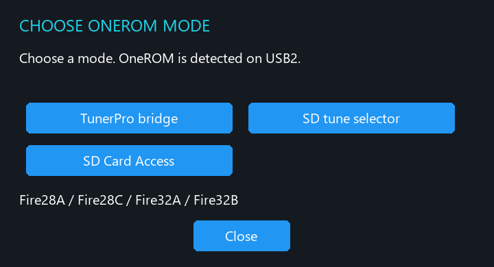
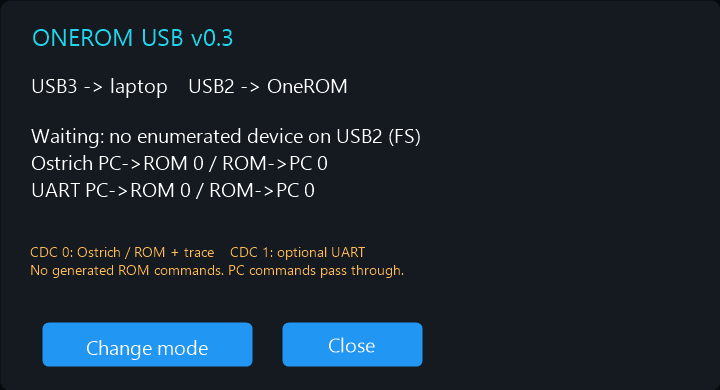
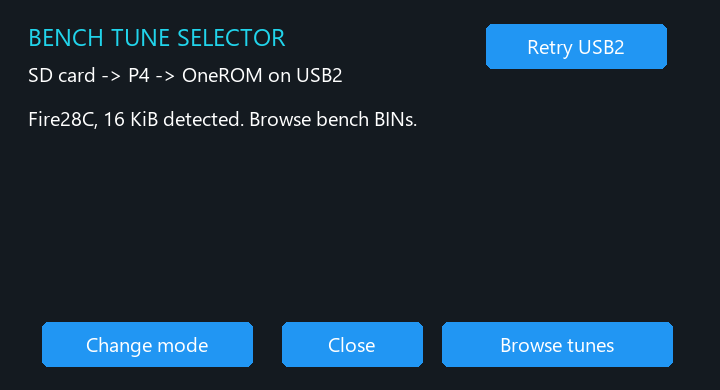
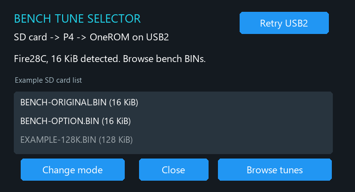
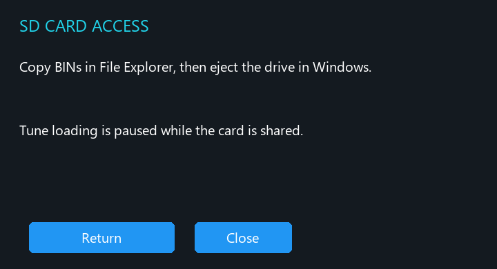
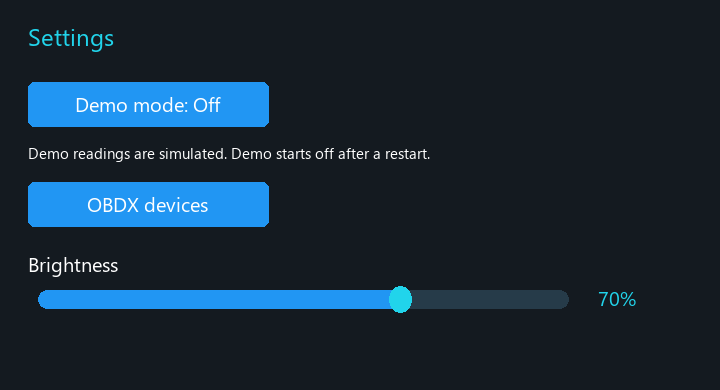

# Commander menu guide

The illustrations are recreated from the firmware layout. Status values and example filenames illustrate the workflow.

## Program and verify OneROM in the Rapid Fire OneROM app

1. Keep OneROM disconnected from the ECU. Connect it directly to your computer and open the Rapid Fire OneROM app.
2. The Rapid Fire OneROM app automatically detects and selects your OneROM board and sets the intended ROM size. Select the **NORMAL DT** firmware profile, then program the tune BIN you want to start with.
3. Read the programmed ROM back in the app and confirm that it matches the intended BIN byte for byte. If you plan to use the SD Tune Selector, put a copy of that verified BIN at the root of the FAT32 microSD card.
4. Once the readback matches, disconnect OneROM from the computer and plug it into Commander's **USB2** port. Open the Commander mode you want to use and confirm that it detects the expected board and ROM size.

## OneROM modes

| Mode | Use |
|---|---|
| TunerPro bridge | Laptop on USB3, OneROM on USB2. Select the P4’s Ostrich COM port in TunerPro RT for emulation. |
| SD tune selector | Browse and load a matching BIN from the FAT32 microSD card onto an isolated OneROM. |
| SD Card Access | Expose the P4’s SD card as a removable drive through USB3. The tune selector and serial bridge pause while this mode owns the card. |

### TunerPro bridge

Connect the laptop to USB3 and the OneROM to USB2. Open **OneROM → TunerPro bridge**. Wait for the board and size to be detected, then find the new COM port in Windows and select it in TunerPro RT for Ostrich emulation. Start with a readback before attempting a write. Some OneROM profiles expose an optional second UART port. The bridge transfers serial data and does not provide GT telemetry to TunerPro.

With a compatible OneROM setup and emulation enabled, TunerPro RT can send live calibration edits while the engine is running. TunerPro RT sends the editor update through Commander's bridge, and OneROM serves the updated data to the ECU. Perform live edits while the vehicle is stationary. See the [TunerPro RT emulation guide](https://www.tunerpro.net/WebHelp/source/emulation.htm).

### Bench Tune Selector

The SD Tune Selector loads the selected BIN image in blocks. Even when two BINs share the same ECU program code, an ECU reading during the transfer can see a mix of old and new calibration data. For SD tune swaps and full BIN uploads, keep the engine off and OneROM disconnected from the ECU, then verify the readback before reconnecting it.

| Fire model | Supported ROM size |
|---|---|
| Fire28A, Fire28C | 16, 32 or 64 KiB |
| Fire32A, Fire32B | 128 KiB, 27C010 |

Commander uses model and active-size metadata from OneROM. Use the matching OneROM v0.8.0 **NORMAL DT** firmware. Unsupported or unreadable profiles stop before a load. Keep OneROM disconnected from the ECU for the entire bench operation.

1. Copy the candidate BINs and a verified copy of the current BIN to the root of a FAT32 card. Use descriptive filenames.
2. Choose **SD tune selector** and check the detected board and ROM size.
3. Tap **Browse tunes**. The list shows up to 64 BIN filenames and sizes. Files of a different size are disabled.
4. Select a compatible file and confirm the bench load. Commander checks the existing image against the card and validates the expected ROM layout before writing. For 32, 64 and 128 KiB images, identical halves fail this check.
5. Wait for **Verified byte for byte**. If a write is incomplete or verification fails, keep OneROM isolated and restore and verify the original BIN using your known bench procedure.

Tap **Retry USB2** if the selector loses the device. The P4 can restart its USB2 host and the OneROM session while the cable stays in place. A retry does not replay a write. For **Change mode**, finish transfers, close TunerPro, turn the engine off and confirm the restart. A restart can discard unsaved tune changes.

### SD Card Access

Choose **SD Card Access** and connect Windows to USB3. Copy files to the card in File Explorer. Eject the drive in Windows and wait for the P4 to show that the card was released. Tap **Return** and select the next mode after the restart. You can also copy files with a separate card reader.

## Dashboard, Engine and Settings

- **Dashboard** and **Engine** show speed, RPM, intake air, coolant, spark advance and battery fields. Unavailable readings display dashes.
- **Settings → Brightness** adjusts the backlight from 10% to 100% and saves on release.
- **Settings → Demo mode** supplies simulated gauge values, marked by a **DEMO** badge. It starts off after a restart.
- **Settings → OBDX devices** opens Bluetooth discovery, connection controls and diagnostics. This release does not implement live ECU gauges or ADX telemetry passthrough.
- **Wideband → Source** chooses Innovate LM-2 or AEM 30-0300. See [wideband setup](WIDEBAND.md) for wiring and signal levels. Use one source at a time.

