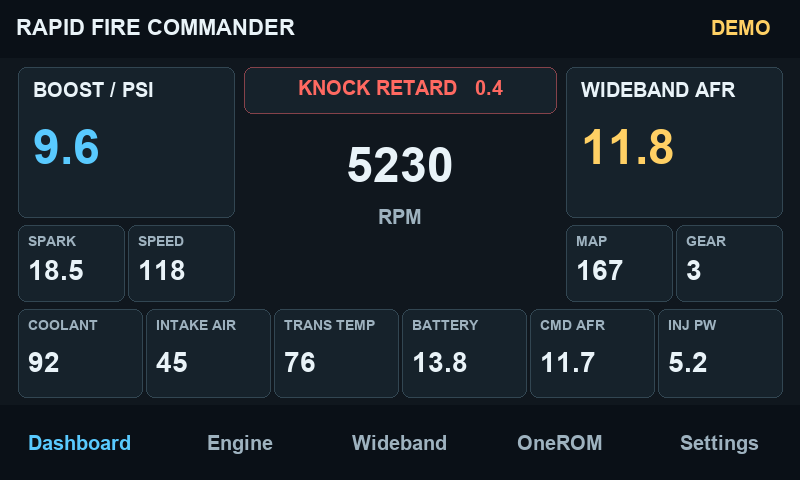

# Rapid Fire Commander

Rapid Fire Commander brings an instrument cluster, OneROM tune selection and TunerPro RT connectivity to the Guition 4.3-inch ESP32-P4 display.

| Edition | Windows connection | Printable A5 guide |
| --- | --- | --- |
| Wired | USB3 serial bridge | [Wired booklet](Rapid-Fire-Commander-Booklet.pdf) |
| Wi-Fi | Commander Wi-Fi and the Windows Companion launcher | [Wi-Fi booklet](https://github.com/RapidFire-001/rapid-fire-commander-wifi/blob/main/Rapid-Fire-Commander-WiFi-Booklet.pdf) |

Choose the kit for your hardware on the [Releases page](https://github.com/RapidFire-001/rapid-fire-commander/releases). Check the asset names for Wired or WiFi. Older releases may only provide Wired.

The Dashboard groups RPM, boost, wideband AFR and knock retard around the centre, with supporting readings for MAP, gear, speed, spark, temperatures, battery, commanded AFR and injector pulse width. **Settings → Demo mode** animates the gauges and marks the screen **DEMO**. Live mode is the startup default. A dash means no valid live value is available.

The **Engine** tab offers **Auto**, **11P** and **12P**. Auto follows a supported tune family after a verified SD tune load. Choose the matching ADX variant and MAP range in TunerPro RT for ECU logging.

- [Install or update on Windows with Espressif Flash Download Tool](WINDOWS.md)
- [Dashboard, Engine, OneROM, SD card and TunerPro help](HELP.md)
- [Wideband wiring and source selection](WIDEBAND.md)
- [Firmware licence](FIRMWARE-LICENCE.md)

Print the PDF for your edition using Booklet mode on A4. For support, email [Rapid Fire Software Support](mailto:support@rapidfiresoftware.net) with your edition, version, board model and the exact error message.
